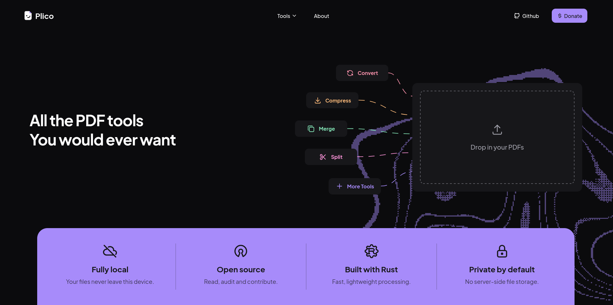
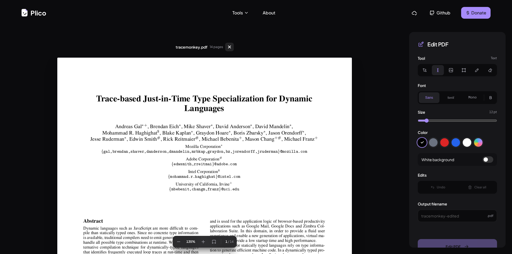

<div align="center">
  
  <h1>Plico</h1>
  <p><strong>PDF tools that run locally.</strong></p>

  <p>
    <a href="https://plico.hexdump0.pw/">Website</a> &nbsp;|&nbsp;
    <a href="https://plico.hexdump0.pw/about">About</a> &nbsp;|&nbsp;
    <a href="https://github.com/hexdump0/plico/issues">Report a bug</a> &nbsp;|&nbsp;
    <a href="https://plico.hexdump0.pw/about#support">Donate</a>
  </p>

  <p>
    <a href="./LICENSE"></a>
    
    
    
  </p>
</div>

Plico is an open-source, local-first PDF tool for merging, splitting, compressing,
reordering, and everything else you can think of. Every file is processed in your browser by a Rust engine compiled to WASM with no server side processing.

## Tools

- **Organize:** Merge, Split, Organize pages, Extract pages, Remove pages, Rotate
- **Edit:** Edit, Sign, Annotate, Crop, Page numbers, Watermark, Forms
- **Convert to PDF:** JPG, PNG, Word, PowerPoint, Excel, HTML, Markdown, Scan
- **Convert from PDF:** JPG, PNG, Word, PowerPoint, Excel, PDF/A, Markdown
- **Optimize & read:** Compress, Repair, OCR, Flatten, Summarize, Translate
- **Security:** Protect, Unlock, Redact, Compare

## Screenshots

<table>
  <tr>
    <th>Home page</th>
    <th>Edit PDF</th>
  </tr>
  <tr>
    <td><a href="./.github/assets/plico-home.png"></a></td>
    <td><a href="./.github/assets/plico-tool.png"></a></td>
  </tr>
</table>

## Privacy

Your documents never leave the browser. A few tools download data the first time you use them, and keep it cached

| Tool      | Downloads                                          | From         |
| --------- | -------------------------------------------------- | ------------ |
| OCR       | Tesseract language data (English ships with Plico) | jsDelivr     |
| Translate | Bergamot translation models, per language pair     | Hugging Face |
| Summarize | Qwen3 0.6B, about 600 MB                           | Hugging Face |

## Run it locally

You need Node.js, Rust with the Wasm target, and `wasm-pack`:

```sh
rustup target add wasm32-unknown-unknown
cargo install wasm-pack   # or, brew install wasm-pack
npm install
npm run dev
```

## Useful commands

```sh
npm run check        # Svelte and TypeScript checks
npm run lint         # Prettier and ESLint
npm run build        # production build
npm run test:engine  # Rust engine tests
npm run test:corpus  # structural checks against a local PDF corpus
```

The corpus checks need test PDFs on disk; [AGENTS.md](./AGENTS.md) explains how to get them.
Known problems and the reasons behind past fixes are in [ISSUES.md](./ISSUES.md).

## License

Plico is licensed under the [GNU Affero General Public License v3.0 or later](./LICENSE).
It includes AGPL components (MuPDF for repair, Ghostscript's ICC profiles for PDF/A),
so the app as a whole is distributed under the AGPL.
